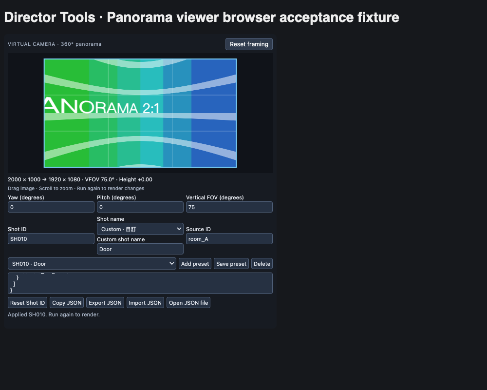

# Super Director Tools

**目前版本：v0.10.3。** 在 ComfyUI 中準備角色、全景與九宮格資產生成提示詞、從 360° 全景取景、保存鏡頭預設、輸出圖片批次與聯絡表，並提供全景接縫檢查和分格選圖工具。

所有節點位於 `image/Super Director Tools` 分類，不需要下載模型或額外安裝依賴。畫質增強和接縫重繪由接在下游的圖生圖模型執行。

| 節點 | 用途 | 輸出 |
| --- | --- | --- |
| **Super Director Tools · Asset Prompt** | 組合角色、無縫全景或九宮格資產生成提示詞 | `prompt`（STRING） |
| **Super Director Tools · Panorama viewer** | 互動全景取景、角度控制、鏡頭預設 | `image`、`prompt`、`presets_json` |
| **Super Director Tools · Batch Panorama** | 按預設清單一次輸出多個鏡頭 | `shot_images`（真正 IMAGE batch）、`contact_sheet`、`metadata_json` |
| **Super Director Tools · Contact Sheet** | 把 IMAGE batch 排成帶編號的聯絡表 | `contact_sheet` |
| **Super Director Tools · Panorama Shift** | 水平循環平移，把左右接縫移到中間檢查 | `image`、`prompt` |
| **Super Director Tools · Grid Split** | 將分鏡格圖拆成單格或整批圖片 | `selected_image`、`all_cells`、`selected_index` |



## 安裝與更新

1. 將完整的 `ComfyUI-DirectorTools` 資料夾放入正在使用的 ComfyUI `custom_nodes` 目錄。
2. 避免多一層同名資料夾，或同時安裝新舊兩份：

   ```text
   ComfyUI/
   └── custom_nodes/
       └── ComfyUI-DirectorTools/
           ├── __init__.py
           ├── nodes.py
           ├── shot_nodes.py
           └── web/
               └── director_tools_panorama.js
   ```

3. 重新啟動 ComfyUI，並重新整理頁面。
4. 搜尋 `Super Director Tools` 新增節點，或拖入下方的範例工作流程。

Python 版本需為 3.10 或以上。使用 ComfyUI 已提供的 PyTorch、NumPy、Pillow，不需要額外 pip 安裝或 Node.js／npm 建置；本專案是 custom node 資料夾，不是用 `pip install .` 安裝的函式庫。球面預覽需要支援 WebGL2 的瀏覽器。

ComfyUI Desktop 請使用該安裝實例的實際 custom nodes 路徑；Windows portable 通常為 `ComfyUI_windows_portable/ComfyUI/custom_nodes/`。

**更新時先儲存工作流程。** 用完整新版資料夾覆蓋舊版。後端修改需要重新啟動 ComfyUI；前端按鈕或選單修改需要重新整理頁面。重新載入後再執行工作流程，才會更新已生成的圖片和聯絡表。

### 舊版本相容性

- **名稱更新：** 套件顯示名稱改為 Super Director Tools；節點 ID、Registry 套件 ID `comfyui-director-tools` 與安裝資料夾名稱維持不變，既有工作流程可繼續使用。

- **v0.8.0：** Batch Panorama 的 `shot_images` 由 IMAGE list 改為單一 IMAGE batch。所有 preset 的 `width`／`height` 必須相同；下游節點改為一次收到整批圖片。混合尺寸請統一尺寸或分開使用 Batch Panorama 節點。
- **v0.7.1：** Contact Sheet 的 `labels` 已改為 `prefix`／`start_number`。舊節點建議重新新增；舊 API 請改用這兩個欄位。
- **v0.5：** 全景節點 ID 統一為 `DirectorToolsPanoramaViewer`。更早的舊名稱 workflow 可重新新增節點並接線，保留相同取景參數。
- **v0.1 workflow：** 保留 `Flat` 模式以維持原圖；新建 Viewer 預設使用 `360 Panorama`。舊 workflow 缺少 `camera_height` 時以 0 開啟。

## 快速開始：取景並輸出整批鏡頭

```text
Load Image ─ image → Panorama viewer ─ presets_json → Batch Panorama
          └ image ──────────────────────────────────→ Batch Panorama
                                                    ├ shot_images → Save Image
                                                    └ contact_sheet → Preview Image
```

1. 把 [test-panorama.png](example_workflows/test-panorama.png) 複製到 ComfyUI 的 `input` 目錄。
2. 拖入 [Viewer → Batch 範例](example_workflows/director_tools_viewer_to_batch.json)。
3. **先執行一次**，讓 Viewer 取得原始全景並顯示節點內預覽。
4. 在預覽內拖曳、滾輪縮放，或輸入 Yaw／Pitch／FOV 取景。
5. 選擇 Shot name，按 **Add preset** 新增鏡頭；換個角度後繼續新增。
6. 所有鏡頭使用相同輸出寬高，再執行一次，輸出整批鏡頭與聯絡表。
7. 儲存工作流程，保留目前取景和全部 preset。

`Batch Panorama.image` 必須接**原始全景圖**。Viewer 的 `image` 已是透視取景結果，應接 Save Image 或圖生圖流程。

如果自行接線時 `presets_json` 顯示文字框，先將該欄位轉成可連線輸入，再接 Viewer 的第三個輸出。

## Asset Prompt：資產生成預備

搜尋 **Super Director Tools · Asset Prompt**，填入人物、場景或道具描述，選擇 `Character`、`Panorama` 或 `Nine-grid asset · 九宮格資產`。節點將自訂描述、模式預設文字和選項組合成一個 `STRING`，直接接生成流程的文字提示詞輸入，例如 CLIP Text Encode 的 `text`。若下游顯示文字框，先轉成可連線輸入。

```text
Asset Prompt ─ prompt → 生成流程的文字輸入 → 角色設定圖／全景圖
```

| 輸入 | 選項與預設 |
| --- | --- |
| `custom_prompt` | 多行人物／場景描述；原文保留，不自動翻譯 |
| `asset_type` | `Character`（預設）／`Panorama`／`Nine-grid asset · 九宮格資產` |
| `grid_asset_type` | 九宮格專用：Character 角色（預設）／Scene 場景／Prop 道具 |
| `aspect_ratio` | 角色／九宮格：Auto（預設）／1:1／16:9／9:16／4:3／3:4／3:2／2:3／2:1／21:9；Panorama 固定 2:1，隱藏此欄位 |
| `language` | `English`（預設）／`繁體中文`；控制加入的預設文字語言 |
| `character_layout` | `Three views`（預設）：正／側／背三視圖；`Three views + face close-up`：另加臉部特寫；`Single full body`：單張全身 |
| `style` | `None`（預設）／Photorealistic／Cinematic／Anime／3D stylized／Concept art |
| `background` | 角色、九宮格角色／道具：None／White／Gray／Simple studio，預設 None |
| `expression` | 角色、九宮格角色：None／Neutral／Happy／Serious，預設 None |
| `environment` | 全景、九宮格場景：None／Indoor／Outdoor，預設 None |
| `time_of_day` | 全景、九宮格場景：None／Dawn／Day／Sunset／Night，預設 None |
| `lighting` | 全景、九宮格場景／道具：None／Natural light／Soft light／Dramatic light，預設 None |

角色提示詞維持五官、髮型、比例、服裝、配件的一致性；三視圖從左至右排列正面、側面、背面，完整顯示頭至腳。臉部特寫模式會要求同一人物的獨立特寫。

全景提示詞要求 **360°×180° 等距柱狀投影、2:1 比例、左右首尾無縫銜接**，接縫處結構、紋理、曝光及光線一致；保留投影在兩極附近應有的拉伸，避免誤生成普通寬幅透視圖或魚眼圖。

切換模式會立即只顯示共用欄位與目前模式專用欄位；另一模式的值保留，切換回來可繼續使用，儲存／載入工作流程亦保留。非目前模式的專用選項不加入輸出。`None` 不加入額外要求，特殊背景、光線或風格可直接寫在 `custom_prompt`。節點使用本地模板，不呼叫模型、LLM 或翻譯服務。例如選 English、輸入中文描述，輸出會包含中文原文與英文預設文字。

**實際全景尺寸需要在生成流程設定**，例如 `2048 × 1024`；文字要求不會改變 latent 或圖片大小，也不能保證模型生成的接縫完美。生成後可用 Panorama Shift 檢查與修補接縫，再用 Panorama viewer 取景。

API 範例：[asset_prompt_api.json](example_workflows/director_tools_asset_prompt_api.json)。這是供嵌入生成流程的節點片段；需要將 `prompt` 輸出接到下游文字輸入，並接上工作流程的輸出節點才會執行。

### 九宮格資產

選 `Nine-grid asset · 九宮格資產`，再選 `grid_asset_type`。輸出要求一張 3×3 設定圖、九個等大的格子；由左至右、由上至下排列，不加文字、粗邊框或格間距。九格呈現**同一資產**的不同視角與細節，維持造型、材質、色調與光線一致。

| 資產類型 | 第 1–9 格內容 | 顯示的專用選項 |
| --- | --- | --- |
| Character 角色 | 正面、左側、右側、背面、正面四分之三、背面四分之三、臉部、手部與配件、服裝材質 | background、expression |
| Scene 場景 | 建立視角、北、45 度俯視、西、頂視平面圖、東、主要焦點區域中景、南、環境細節特寫 | environment、time_of_day、lighting |
| Prop 道具 | 正面、背面、左側、右側、頂面、底面、正面四分之三、背面四分之三、材質結構細節 | background、lighting |

三種資產共用 custom_prompt、asset_type、language、style、aspect_ratio，並顯示 grid_asset_type；原本的 character_layout 在九宮格模式隱藏。語言和原文保留規則沿用其他模式。

場景九宮格採固定位置（上下左右＝北南西東）：

| 左 | 中 | 右 |
| --- | --- | --- |
| 全景建立視角 | 朝北 | 45 度俯視斜角 |
| 朝西 | 頂視平面圖 | 朝東 |
| 主要焦點區域中景 | 朝南 | 環境細節特寫 |

中央平面圖使用正投影、北朝上、東朝右；另外八格使用透視視圖。東南西北四格從同一基準位置取景，保持相同高度與視野，轉向指定方位，場景佈局和地標需對應中央平面圖。格子在設定圖中的位置與平面圖本身的朝向分別定義；不加入方位文字或箭頭。

`aspect_ratio` 指**整張設定圖**的寬高比，3×3 等分後每格比例亦相同。Auto 預設為 1:1；選 16:9 時，整張和每格都要求 16:9，不會再加入正方形要求。角色模式選 Auto 時不指定比例；Panorama 始終使用 2:1，切回其他模式會保留原先的比例值。

生成尺寸需另外配合所選比例，例如 1:1 使用 `1536 × 1536`、16:9 使用 `2304 × 1296`；提示詞不會改變實際尺寸。生成後用 Grid Split 設 `rows=3`、`cols=3`、`separator_px=0`，即可取單格或 IMAGE batch。模型可能未完全遵守格線或跨格一致性，請先檢查生成結果。這個模式輸出 STRING，並不直接生成九張圖片或 IMAGE batch。

新欄位位於 widgets 最後，且 API 可省略 `grid_asset_type`（預設角色），保留既有 Character／Panorama 工作流程。API 範例：[nine_grid_asset_api.json](example_workflows/director_tools_nine_grid_asset_api.json)。

## Panorama viewer：互動取景

主要輸入是單張 RGB、2:1 的 equirectangular 全景圖。`360 Panorama` 模式將圖片當作完整 360°×180° 的球面環境，輸出正常透視圖片；`Flat` 模式提供平面裁切／縮放。

```text
Load Image → Panorama viewer ─ image → Save Image / 圖生圖模型
                            ├ prompt → 模型文字提示詞輸入
                            └ presets_json → Batch Panorama
```

### 預覽操作

- 在預覽內拖曳轉動視線；360 模式可跨越左右接縫，完整水平轉動一圈。
- 滾輪向上拉近、向下拉遠。滑鼠在預覽內控制鏡頭，預覽外才縮放工作流程畫布。
- 方向鍵移動視角，Shift 加大移動量，`+`／`-` 縮放。
- **Reset framing** 回到居中、1×、高度 0，保留輸出尺寸。
- 調整只更新本地預覽；需要再執行工作流程才會產生正式輸出。上游圖片變更後，也需再執行一次。

### 參數與角度

| 參數 | 說明 |
| --- | --- |
| `image` | 單張浮點 RGB IMAGE，shape `[1,H,W,3]`；若上游是 batch，先選出一張。 |
| `projection` | `360 Panorama`：球面預覽與透視輸出；`Flat`：平面裁切。 |
| `aspect_ratio` | `16:9`、`9:16`、`1:1`、`4:3`、`3:2`、`2.39:1`、`Free`。 |
| `width`／`height` | 各為 1–8192 像素。鎖比例時，修改一邊會同步另一邊並四捨五入；`Free` 可獨立設定。 |
| `center_x`／`center_y` | 0–1，預設 0.5。360 模式 x=0／1 是接縫方向，x=0.5 是原圖中央；y=0.5 為水平視線，較小值向上。 |
| `zoom` | 0.5–32×。360 模式 1× 的垂直 FOV 為 75°，2× 約 42°；0.5× 約 113.82°。Flat 模式 zoom ≤ 1 維持滿版。 |
| `camera_height` | -0.8～0.8，預設 0，以球半徑為單位；正值向上、負值向下。只對 360 模式生效。 |
| `Yaw (degrees)` | -180°～180°，0° 對應原圖中央，正值向右。 |
| `Pitch (degrees)` | ±89.9°，正值向上。 |
| `Vertical FOV (degrees)` | 約 2.747°～113.82°，與 zoom 對應；水平 FOV 由輸出比例推導。 |

角度欄位與拖曳、縮放及標準 widgets 同步；Flat 模式停用角度欄位。`Free` 允許任意輸出比例，預覽仍採固定畫框。

高度是單位球殼內的模擬視點移動，並非公尺。單張全景沒有真實深度，無法重建遮擋區域或正確近遠視差；離球心越遠，近處物件越可能變形。預覽與正式輸出使用相同投影規則。

兩種模式皆使用雙線性插值。正式輸出保留輸入 tensor 的 dtype／device，沒有 AI 超解析。API 使用鎖比例時，也必須提供相符的 `width`／`height`。

### 圖生圖修復提示詞

`prompt` 是英文編輯指令，用於改善細節、材質、清晰度，減少模糊、噪點、壓縮痕跡，修正不自然的廣角邊緣拉伸。360 模式另加入殘留球面彎曲的修正要求；非零高度會加入偏心視點變形的說明。

指令要求保留人物、場景配置、構圖、光線、色彩和風格，也保留正常透視匯聚與刻意彎曲的物件。它由下游模型執行，Viewer 本身只輸出投影／裁切圖片。

輸出順序固定為 `image`（IMAGE，索引 0）、`prompt`（STRING，索引 1）、`presets_json`（STRING，索引 2）。

## 鏡頭預設：新增、更新與重新編號

### Shot name

下拉選單提供以下常用名稱，並附中文說明：

| 選項 | 中文說明 | 選項 | 中文說明 |
| --- | --- | --- | --- |
| Establishing | 建立鏡頭 | Extreme wide | 大遠景 |
| Wide | 全景 | Full | 全身 |
| Medium wide | 中遠景 | Medium | 中景 |
| Medium close-up | 中近景 | Close-up | 特寫 |
| Extreme close-up | 大特寫 | Over-the-shoulder | 過肩 |
| POV | 主觀視角 | Two-shot | 雙人鏡頭 |
| Insert | 插入鏡頭 | Detail | 細節 |

選 **Custom · 自訂** 可填寫自己的名稱。已有自訂名稱會自動切換到自訂模式並恢復文字。Shot name 只是標籤，選擇它不會自動改變角度或視野。

### 預設控制

| 控制 | 行為 |
| --- | --- |
| **Add preset** | 保存目前取景，Shot ID 自動加 1，例如 `SH010 → SH011`；保留補零格式、跳過已存在的編號，並選中新預設。 |
| **Save preset** | 按輸入的 Shot ID 保存；同 ID 原位更新鏡頭，不同 ID 新增到末尾。 |
| **Saved shots** | 選取後立即套用角度、尺寸、比例和高度，更新預覽與對應數值；無需 Apply preset。 |
| **Reset Shot ID** | 按目前清單順序重新編號為 `SH001、SH002…`，保留選中的鏡頭、名稱與取景設定，同步更新 JSON。 |
| **Delete** | 移除目前選定的預設。 |
| **Copy JSON** | 複製完整清單；剪貼簿存取失敗時，可手動複製已選取的文字。 |
| **Export JSON** | 下載 `camera_presets.json`。 |
| **Import JSON／Open JSON file** | 用貼上的 JSON 或檔案取代預設清單；驗證失敗時保留原清單。匯入後選取鏡頭以套用。 |

Add preset 以 Shot ID 欄位為基準：沒有數字結尾時附加 `001`，欄位空白時從 `SH001` 開始。預設欄位是 `SH010`，所以直接按 Add 會建立 `SH011`；若要從 `SH001` 建立，可先清空欄位，或在空清單按 Reset Shot ID。

空清單的 Reset Shot ID 會把欄位設為 `SH000`，下一次 Add 從 `SH001` 開始。已有預設時，重新編號依清單順序進行，不依舊 ID 排序；已匯出的 JSON 或已保存的圖檔不會回溯改名。

修改取景不會自動覆寫已保存的 preset；要更新鏡頭請按 Save preset。保存工作流程會保留節點 properties 中的清單；Viewer 的 `presets_json` 輸出讀取這份清單，包含 Add、Save、Delete 和 Reset 的結果。

`Source ID` 是全景資產標籤，不會自動載入或核對圖片。每份清單必須使用同一個 Source ID；換上游圖時需自行確認。Shot ID 僅接受英文字母、數字、底線、連字號，忽略大小寫後必須唯一；ID、名稱與 Source ID 最多 80 字元。

格式見 [camera_presets.json](example_workflows/camera_presets.json)：

```json
{
  "schema_version": 1,
  "shots": [{
    "shot_id": "SH001", "name": "Wide", "source_id": "panorama_A",
    "yaw": 0, "pitch": 0, "vertical_fov": 75,
    "width": 1280, "height": 720, "aspect_ratio": "16:9", "camera_height": 0
  }]
}
```

## Batch Panorama：真正的 IMAGE batch

接入一張原始全景和 `presets_json`。JSON 可直接接 Viewer 輸出，或貼入／匯入已有清單。

| 輸入／輸出 | 說明 |
| --- | --- |
| `image` | 單張浮點 RGB 全景，shape `[1,H,W,3]`。 |
| `presets_json` | 至少一個鏡頭的預設文件；所有鏡頭的 `width`／`height` 必須相同。 |
| `columns` | 聯絡表每行 1–8 格，預設 3。 |
| `thumb_size` | 聯絡表縮圖最長邊，64–512 像素，預設 256。 |
| `save_files` | 預設關閉；開啟時，執行會保存每個鏡頭的 PNG 和 JSON。 |
| `shot_images` | 單一 IMAGE tensor batch，shape `[鏡頭數,H,W,3]`，依清單順序排列。 |
| `contact_sheet` | 單張聯絡表；縮圖保持原比例，底部有獨立的 Shot ID 標籤帶。 |
| `metadata_json` | 完整鏡頭設定、來源像素尺寸、投影資訊，以及存檔時的子目錄。 |

`shot_images` 可直接接 Save Image、Contact Sheet、批次選圖及支援 batch 的圖片節點。它不再是逐項執行的 IMAGE list。混合尺寸會在取樣或存檔前報錯，請統一寬高，或分開使用不同 Batch Panorama 節點。

每次最多 64 鏡，總量上限為 32 megapixels（33,554,432 像素）。正式鏡頭保留輸入 dtype／device，聯絡表是 CPU float32 的 8-bit 視覺摘要。Batch 使用球面透視投影，沒有真實 3D 位移或深度重建。

開啟 `save_files` 後，檔案保存在：

```text
output/director_tools/<唯一批次目錄>/
├── shot_SH001.png
├── shot_SH001.json
├── shot_SH002.png
├── shot_SH002.json
└── camera_presets.json
```

PNG 為 8-bit；JSON 保留對應鏡頭設定。每次明確存檔執行使用新目錄。這與連接到 Save Image 的一般圖片輸出可同時使用。

## Contact Sheet：按圖片比例排列的聯絡表

Batch Panorama 已提供按 Shot ID 標示的聯絡表；獨立的 **Super Director Tools · Contact Sheet** 可把任意同尺寸 RGB IMAGE batch 排成聯絡表，例如 `Batch Panorama.shot_images` 或 `Grid Split.all_cells`。

```text
IMAGE batch → Contact Sheet → Preview Image / Save Image
```

| 參數 | 說明 |
| --- | --- |
| `images` | 浮點 RGB IMAGE batch，1–64 張。 |
| `columns` | 每行 1–8 格，預設 3；圖片少於欄數時會縮減欄數。 |
| `thumb_size` | 每張縮圖的最長邊，64–512 像素，預設 256。 |
| `prefix` | 編號前綴，預設 `SH`；留空只顯示數字。 |
| `start_number` | 起始數字，0–999999999，預設 1。 |

例如 `prefix=SH`、`start_number=10`，輸出 `SH010、SH011、SH012…`；`prefix=Shot_` 則為 `Shot_010、Shot_011…`。數字至少補滿三位，超過 999 後正常顯示 1000、1001。

兩種聯絡表共用相同比例排列：縮圖最長邊由 thumb_size 控制，短邊按圖片比例縮放；格子不再強制正方形。每張圖下方另有 **24 像素標籤帶**，最後一行未用滿的格子保留背景。

以 16:9、`thumb_size=187`、兩欄三張為例：每張縮圖為 `187×105`，聯絡表為 **374×258**，移除舊版正方形格子的多餘上下黑邊，不裁切或拉伸圖片。

聯絡表只作預覽，不改動原始圖片。標籤使用英數短文字；非 ASCII 字元在圖上顯示為 `?`。Batch 的鏡頭名稱仍完整保存在 JSON；獨立 Contact Sheet 按 prefix／start_number 編號，不會讀取 Batch metadata 的 Shot ID。

## Panorama Shift：檢查與修補左右接縫

```text
Load Image → Panorama Shift ─ image → Preview Image / 圖生圖模型
                            └ prompt → 模型文字提示詞輸入
```

`shift_x` 是圖片寬度的比例，範圍 -1～1：正值向右、負值向左。預設 **0.5** 循環平移半張圖，將原本左右邊界的接縫移到中央。

移出一側的像素從另一側接回，不裁切、補邊、縮放或插值，保留原尺寸、像素、dtype／device。支援多張 IMAGE batch 和 1／3／4 通道。平移量四捨五入至整數像素，半像素向遠離零的方向取整；奇數寬度的接縫落在中央附近。0、1、-1 不改變像素排列。

`prompt` 是英文局部重繪指令，會標明原接縫平移後的實際像素位置，只允許重新生成接縫附近最小範圍的內部窄帶；預設 `shift_x=0.5` 時即為中央區域。左右區域（包含最外側邊緣）明確鎖定，不得重畫、調色、改光或混合，窄帶以外的像素要求原樣保留，避免破壞平移後已有的左右循環連接。窄帶內修正斷線、重影、材質錯接、色差與曝光差，並銜接兩側未修改的內容，保留等距柱狀全景投影與極區的正常拉伸。接縫仍在外側時（例如 `shift_x=0`、`1`、`-1` 或平移量取整為零），prompt 要求原圖不變，提示先用 `0.5` 將接縫移入中央；單像素寬的圖片沒有可修補的內部接縫。建議用於 2:1 全景；普通圖片仍可平移。

文字提示無法保證生成模型逐像素保留左右區域。若需嚴格保留，請在下游使用僅覆蓋中央接縫窄帶的 inpainting 遮罩，並將重繪結果的遮罩外區域合成回原始 shift 圖片。

節點本身不自動檢測或修補接縫。完成下游重繪後，若需回到原朝向，再接一個 Shift 並使用相反值，例如 `0.5 → -0.5`；模型需保留尺寸。還原時只使用第二個節點的 image 輸出即可。

## Grid Split：分格選鏡頭

```text
Load Image → Grid Split ─ selected_image → Preview Image / 後續圖片或影片流程
                       └ all_cells → Contact Sheet / 批次圖片流程
```

`rows=3`、`cols=3`、`shot_number=5` 可取得九宮格中央格，編號由左至右、由上至下：

```text
1  2  3
4  5  6
7  8  9
```

| 參數／輸出 | 說明 |
| --- | --- |
| `image` | 一張或多張浮點 IMAGE，支援 1／3／4 通道。接 Contact Sheet 時需為 RGB。 |
| `rows`／`cols` | 各 1–64，不能超過圖片高／寬。 |
| `shot_number` | 從 1 開始，不能超過 rows × cols；可轉為 INT 接線輸入。 |
| `separator_px` | 內部分隔帶寬度，0–4096 像素，預設 0；不扣外框。 |
| `selected_image` | 每張來源圖的指定格，保留裁切尺寸和像素。 |
| `all_cells` | 全部格的 IMAGE batch，逐行排列；先排來源圖 0 的全部格，再排來源圖 1。 |
| `selected_index` | shot_number − 1，為各來源圖內的 0-based 格序號。 |

separator_px 不自動偵測；無分隔線時使用 0，有線時填入相鄰格之間的線寬。扣除內部分隔帶後平均分格，各格最多差一像素；分隔帶過寬會報錯。

all_cells 需要同尺寸，因此較小格的右／底邊會複製邊緣像素補齊，沒有縮放或刪除格內來源像素；selected_image 不補邊。來源圖 b 的指定格在 all_cells 中的索引為 `b × rows × cols + selected_index`。

## 保存工作流程與預覽

Viewer 的比例、尺寸、中心位置、zoom、projection 和高度保存在標準 inputs／widgets，預設清單保存在節點 properties。Workflow 不內嵌全景原圖像素。

預覽使用最多 1536 像素長邊的暫存 8-bit PNG；暫存檔仍在時，重開可顯示預覽，已清除時再執行一次即可恢復。高倍率的正式出圖會比縮小預覽保留更多細節。

每次執行 Viewer 都重新輸出暫存預覽；上游節點仍可使用 ComfyUI 快取。拖曳、縮放、選取 preset 不會自行提交生成工作。

## 範例工作流程與 API

先將範例使用的圖片放進 ComfyUI `input` 目錄。UI JSON 可拖入 ComfyUI；API JSON 可提交到 `/prompt`。

| 用途 | UI workflow | API payload |
| --- | --- | --- |
| Viewer → Batch 直接接線 | [director_tools_viewer_to_batch.json](example_workflows/director_tools_viewer_to_batch.json) | — |
| 單張全景取景 | [director_tools_panorama.json](example_workflows/director_tools_panorama.json) | [director_tools_panorama_api.json](example_workflows/director_tools_panorama_api.json) |
| 批次全景取景 | [director_tools_batch.json](example_workflows/director_tools_batch.json) | [director_tools_batch_api.json](example_workflows/director_tools_batch_api.json) |
| 水平平移及接縫提示詞 | [director_tools_panorama_shift.json](example_workflows/director_tools_panorama_shift.json) | [director_tools_panorama_shift_api.json](example_workflows/director_tools_panorama_shift_api.json) |
| 分格選圖 | [director_grid.json](example_workflows/director_grid.json) | [director_grid_api.json](example_workflows/director_grid_api.json) |

全景範例使用 [test-panorama.png](example_workflows/test-panorama.png)，分格範例使用 [test-grid.png](example_workflows/test-grid.png)。

```sh
curl -X POST http://127.0.0.1:8188/prompt \
  -H 'Content-Type: application/json' \
  --data-binary @example_workflows/director_tools_batch_api.json
```

Viewer 的純 API 球面取景需明確傳入 `"projection": "360 Panorama"`；省略時保留舊版 Flat 行為。只需保存圖片時，可接 Save Image。

Viewer 的 presets_json 輸出依賴隨執行提交的 workflow properties。純 API 若要讀取該輸出，需要在 `extra_data.extra_pnginfo.workflow.nodes` 中包含 Viewer 的 ID 和 `properties.director_tools_shots`；也可直接把 JSON 傳給 Batch Panorama 的 presets_json，無需 Viewer。

## 問題排查

| 問題 | 處理方式 |
| --- | --- |
| 找不到節點 | 檢查資料夾層級和 `__init__.py`，重新啟動 ComfyUI，查看啟動時是否有 import error。 |
| 沒有新按鈕、仍顯示舊介面 | 儲存 workflow 後重新整理頁面，確認未停用 `DirectorToolsPanoramaViewer.FixedViewport` extension。 |
| 沒有圖片或 preview expired | 接上 IMAGE 並執行一次；載入 workflow 本身不會執行上游節點。 |
| Batch 提示 same width and height | 統一全部 preset 的 width／height；混合尺寸分開用不同 Batch 節點。 |
| Batch 提示沒有鏡頭 | 先按 Add preset 或 Save preset，或提供至少一個鏡頭的 JSON。 |
| 聯絡表仍有舊的大片黑邊 | 重新啟動 ComfyUI，再執行一次更新圖片；最後一行的空格和標籤帶仍會保留。 |
| 輸出尺寸不符比例 | 使用尺寸 widgets 同步，或在 API 提供相符寬高；任意比例選 Free。 |
| Viewer 收到多張來源圖 | 先選出一張；Batch Panorama 也只接受一張來源全景。Shift／Grid Split 可接受 batch。 |
| 舊 workflow 顯示平面圖 | 將 projection 從 Flat 切換為 360 Panorama。 |
| 顯示 WebGL2 提示 | 啟用瀏覽器硬體加速後重新載入，或使用支援 WebGL2 的瀏覽器。 |

## 最近更新

- **v0.10.3：** 修正九宮格場景方位為上北、下南、左西、右東。
- **v0.10.2：** 九宮格場景改為中央頂視平面圖、四邊東南西北與四角指定視圖，加入方位與佈局一致性要求。
- **v0.10.1：** Asset Prompt 新增長寬比；角色／九宮格支援常用比例，九格跟隨整張比例，Panorama 固定 2:1。
- **v0.10.0：** Asset Prompt 新增九宮格資產模式，提供角色／場景／道具的九格視圖與模式專用欄位。
- **v0.9.1：** Asset Prompt 依角色／Panorama 模式立即顯示對應參數，保留隱藏欄位的值。
- **v0.9.0：** 新增 Asset Prompt，提供角色／Panorama 模式、中英文模板、三視圖與臉部特寫、常用生成選項。
- **v0.8.2：** Reset Shot ID，依清單順序重新編號並同步 JSON。
- **v0.8.1：** 聯絡表格子跟隨圖片比例，移除正方形格子的多餘黑邊。
- **v0.8.0：** Batch Panorama 直接輸出真正 IMAGE batch，要求同尺寸鏡頭。
- **v0.7.6：** Shot name 常用名稱選單及自訂名稱。
- **v0.7.5：** Add preset，自動遞增 Shot ID；移除 Apply preset 按鈕。
- **v0.7.3–0.7.4：** 選取 preset 立即套用預覽和數值，版本化前端模組載入。
- **v0.7.2：** Viewer 新增 presets_json 輸出，可直接接 Batch Panorama。
- **v0.7.1：** Contact Sheet 使用 prefix／start_number 自動編號。
- **v0.7.0：** Panorama Shift 與接縫修補 prompt。

## 開發與驗證

```text
__init__.py                       節點註冊與 WEB_DIRECTORY
asset_prompt.py                  角色／全景資產生成提示詞組合
grid_asset_prompt.py             九宮格資產雙語模板與九格視圖
nodes.py / geometry.py            Viewer、投影、取樣與 source preview
shots.py / shot_nodes.py           預設驗證、Batch、Contact Sheet
panorama_shift.py                 水平循環平移與接縫 prompt
refinement_prompt.py              取景圖片的圖生圖修復 prompt
director_tools.py                 Grid Split
web/director_tools_panorama.js    前端入口
web/director_tools_asset_prompt.js Asset Prompt 模式欄位入口
web/lib/asset_prompt_controls.mjs 模式欄位顯示與 workflow 恢復
web/lib/extension.mjs             節點 hooks 與 workflow 生命週期
web/lib/viewport.mjs              預覽與鏡頭互動
web/lib/shot_controls.mjs         名稱、角度及 preset 控制
web/lib/presets.mjs               預設驗證、角度換算與 ID 工具
web/lib/panorama_renderer.mjs     WebGL2 球面預覽
web/lib/geometry.mjs              前端鏡頭幾何及尺寸同步
example_workflows/               範例 JSON 與測試圖片
tests/                           Python、JavaScript、瀏覽器與 ComfyUI 驗證
docs/                            設計與驗證記錄
```

在 ComfyUI 的 Python 環境執行後端測試：

```sh
python -m unittest discover -s tests -p 'test_*.py'
```

JavaScript 單元測試使用 Node.js 18+，不需 npm 安裝依賴：

```sh
npm test
```

瀏覽器測試需自行提供 Playwright 和 Chrome，僅用於開發：

```sh
PLAYWRIGHT_MODULE=/absolute/path/to/playwright node tests/browser-smoke.mjs
```

真實 ComfyUI 執行測試請指向獨立測試實例；下列測試會提交工作並寫出範例檔案：

```sh
COMFY_TEST_URL=http://127.0.0.1:8199 python tests/comfy-shots-smoke.py
PLAYWRIGHT_MODULE=/absolute/path/to/playwright COMFY_TEST_URL=http://127.0.0.1:8199 \
  node tests/comfy-viewer-presets-browser.mjs
```

已驗證環境與結果見 [docs/validation.md](docs/validation.md)，包括 ComfyUI 0.38.2／frontend 1.53.6。其他版本請依實際測試確認。

參考：[官方 Python 節點 API](https://docs.comfy.org/custom-nodes/backend/server_overview)、[IMAGE 格式](https://docs.comfy.org/custom-nodes/backend/images_and_masks)、[JavaScript hooks](https://docs.comfy.org/custom-nodes/js/javascript_hooks)。全景行為參考 [ComfyUI_preview360panorama](https://github.com/ProGamerGov/ComfyUI_preview360panorama)；投影由原生 WebGL2／PyTorch 實作，沒有 Three.js 依賴。

## Registry 發佈（維護者）

Publisher 為 [mch000534](https://registry.comfy.org/zh/publishers/mch000534)，節點 ID 為 `comfyui-director-tools`。發佈版本取自 `pyproject.toml`，同一版本不可重複發佈。

自動發佈工作流程會在 `main` 分支的 `pyproject.toml` 更新後檢查 Registry。將版本改為尚未發佈的版本（例如 `0.10.4`）並推送到 `main`，工作流程就會發佈該版本；一般程式碼或中繼資料更新若未提高版本，會略過發佈。也可在 GitHub Actions 的「Publish to Comfy Registry」工作流程選擇 **Run workflow** 手動執行。工作流程會先查詢 Registry；已存在的相同版本會略過，且不能覆寫。

在 Actions 開啟該次 workflow run，查看版本檢查步驟的記錄：若版本已存在，會顯示略過；若需發佈，請確認 **Publish node** 步驟成功。步驟失敗時，開啟該步驟的記錄查看錯誤。

請在 GitHub 儲存庫 **Settings → Secrets and variables → Actions** 新增名為 `REGISTRY_ACCESS_TOKEN` 的 repository secret，值使用該 Publisher 的 Registry API Key。工作流程只在需要發佈時要求此 secret。

安裝官方 `comfy-cli` 後，在此專案根目錄執行：

```sh
comfy node validate
comfy node pack
comfy node publish
```

最後一個指令會以隱藏輸入要求該 Publisher 的 Registry API Key。金鑰不可放入專案或提交到 Git。發佈前請提交版本與設定變更；CLI 只打包 Git 已追蹤的檔案，並依 `.comfyignore` 排除測試及開發設計文件，保留節點、前端、說明圖片與範例工作流程。後續發佈需先更新 `pyproject.toml` 和本文件的版本，再執行測試與打包檢查。

流程參考：[官方 Registry 發佈指南](https://docs.comfy.org/registry/publishing)。

## 授權

[MIT License](LICENSE)。
